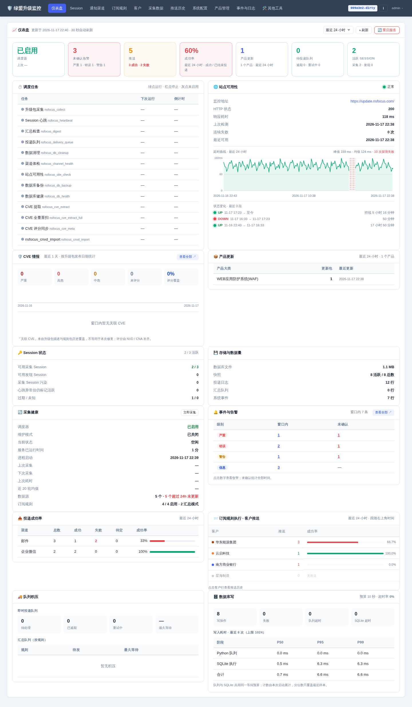
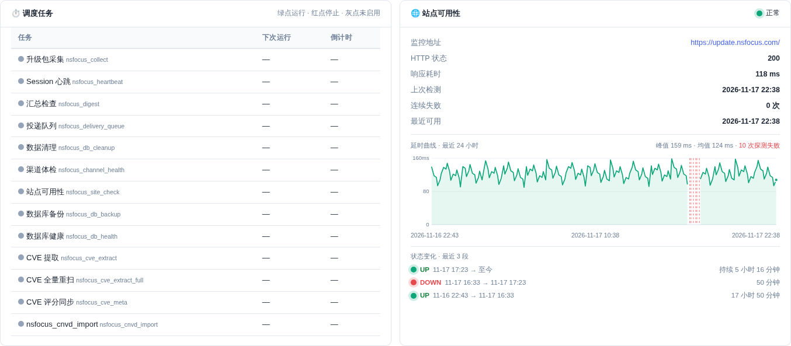
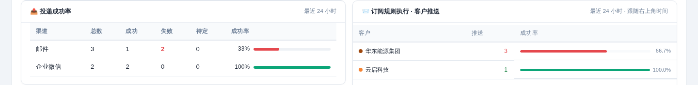
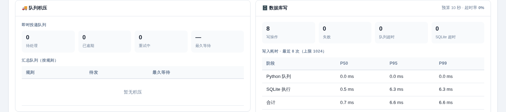

# 绿盟升级监控平台 · 用户手册（图文版）

> 版本：v1.6 · 更新：2026-11-18
>
> 本文先按上线顺序讲**配置流程**，再按页面讲**功能与指标**，最后是运维场景与 FAQ。
> 截图取自隔离演示实例（1440×900，示例数据），时间与数字仅用于说明。
> 参数默认值与接口细节见 [用户手册.md](用户手册.md)，接口定义见 [API接口文档.md](API接口文档.md)。

---

## 目录

**第一部分 · 配置流程**

1. [配置总览：先配什么，后配什么](#1-配置总览先配什么后配什么)
2. [登录系统](#2-登录系统)
3. [配置通知渠道](#3-配置通知渠道)
4. [配置会话（Session）](#4-配置会话session)
5. [建立客户与资产台账](#5-建立客户与资产台账)
6. [创建订阅规则](#6-创建订阅规则)
7. [调整系统配置](#7-调整系统配置)
8. [验证与上线](#8-验证与上线)

**第二部分 · 功能讲解**

9. [仪表盘](#9-仪表盘)
10. [事件与日志](#10-事件与日志)
11. [客户](#11-客户)
12. [订阅规则](#12-订阅规则)
13. [推送历史](#13-推送历史)
14. [Session](#14-session)
15. [通知渠道](#15-通知渠道)
16. [采集数据](#16-采集数据)
17. [系统配置参数详解](#17-系统配置参数详解)

**第三部分 · 运维与排障**

18. [典型场景](#18-典型场景)
19. [常见问题](#19-常见问题)

---

# 第一部分 · 配置流程

## 1. 配置总览：先配什么，后配什么

一条推送从产生到送达，依赖四个前提：**能采集**（Session）、**有条件**（订阅规则）、**有对象**（客户与渠道）、**有开关**（系统配置）。按下面顺序配置，可以少走回头路：

| 步骤 | 页面 | 产出 | 是否可跳过 |
|------|------|------|------------|
| 1 | 通知渠道 | 至少一个可用的邮件或机器人渠道 | 不能，否则规则无处投递 |
| 2 | Session | 至少一个「采集」类型的有效登录态 | 不能，否则没有升级包数据 |
| 3 | 客户 | 客户档案 + 持有产品与版本 | 不能，规则必须关联客户 |
| 4 | 订阅规则 | 客户 × 条件 × 渠道 × 推送策略 | 不能，规则决定发什么 |
| 5 | 系统配置 | 采集间隔、限流、静默时段、观测接入 | 建议逐项确认 |
| 6 | 验证 | 手动推送成功 + 看板指标正常 | 上线前必须做 |

**最小可用路径**：渠道 → Session → 客户 → 规则，四步即可收到第一条推送。系统配置可以在运行中再调。

> 建议先在测试环境用一个小号或测试群跑通全链路，再切到客户正式邮箱。

---

## 2. 登录系统

浏览器打开服务地址（默认 `http://<服务器IP>:9999`），进入登录页：


| 元素 | 说明 |
|------|------|
| 用户名 | 管理员账号，首次部署默认为 `admin` |
| 密码 | 见 [2.1 初始密码从哪里来](#21-初始密码从哪里来) |
| 登录 | 校验通过后写入 HttpOnly 会话 Cookie；关闭浏览器前保持登录 |

登录后进入仪表盘。若页面白屏或反复跳回登录页，先确认服务状态与浏览器是否禁用了 Cookie。

> 会话 Cookie 不可被前端脚本读取，CSRF 令牌单独放在可读 Cookie 中，由页面自动携带。

### 2.1 初始密码从哪里来

首次启动时，如果数据库里还没有任何用户，服务会自动创建管理员 `admin`，并生成一个随机密码。密码只以两种形式出现一次：

1. **密码文件**：`<数据目录>/initial_password.txt`
2. **启动日志**：服务启动时打印到 stderr（`start.sh` 会写入 `logs/stdout.log`）

按部署方式获取：

| 部署方式 | 获取命令 |
|----------|----------|
| 本机 / systemd | `cat /root/nsfocus-monitor/data/initial_password.txt` |
| systemd 启动日志 | `journalctl -u nsfocus-monitor -b \| grep -A2 初始密码` |
| 自定义数据目录 | `cat "$MONITOR_DATA_DIR/initial_password.txt"` |
| Docker | `docker exec nsupdate-monitor cat /app/data/initial_password.txt` |
| 宿主机挂载目录 | `cat ~/nsfocus-monitor/data/initial_password.txt` |

> 密码以 bcrypt 哈希存库，明文只写入上述文件。创建过用户后再次重启不会重新生成；文件不存在时说明已被删除或数据目录不对，直接按 2.3 重置即可。

### 2.2 首次登录后修改密码

点右上角用户名 →「🔒 修改密码」：

| 字段 | 说明 |
|------|------|
| 旧密码 | 当前密码 |
| 新密码 | 至少 4 位 |
| 确认新密码 | 与新密码一致 |

修改成功后，建议删除 `initial_password.txt`，或至少收紧权限：

```bash
rm -f /root/nsfocus-monitor/data/initial_password.txt
# 或保留但仅 root 可读
chmod 600 /root/nsfocus-monitor/data/initial_password.txt
```

### 2.3 忘记密码 / 重置密码

使用仓库自带脚本，服务运行中可直接执行，无需停服：

```bash
cd /root/nsfocus-monitor
python3 scripts/reset_password.py --username admin --password '你的新密码'
```

Docker 部署：

```bash
docker exec nsupdate-monitor \
  python3 scripts/reset_password.py --username admin --password '你的新密码'
```

注意：

- 脚本直接写数据库，执行后立即生效
- 如果设置了 `MONITOR_DATA_DIR`，确保脚本与服务指向同一个数据目录
- 新密码不要写进脚本、仓库或工单；执行完清理 shell 历史

### 2.4 多用户与注册关闭

系统首次初始化后即关闭注册：数据库中已有用户时，注册接口返回 403。当前版本没有用户管理页面，按单管理员账号设计；如需多账号，需要自行在 `users` 表写入 bcrypt 哈希记录，暂不作为标准支持流程。

---

## 3. 配置通知渠道

**路径**：主导航「通知渠道」→ 右上角「+ 添加渠道」。

### 3.1 选择渠道类型

| 类型 | 适用场景 | 必填项 |
|------|----------|--------|
| 企业微信 | 运维群、客户服务群 | Webhook URL（可选 Secret 签名） |
| 钉钉 | 运维群、客户服务群 | Webhook URL（可选加签密钥） |
| 飞书 | 运维群、客户服务群 | Webhook URL |
| 邮件 | 正式客户通知、需要附件 | SMTP 主机、端口、用户名、密码 / 授权码、发件人、SSL 选项 |

### 3.2 邮件渠道填写要点

- **用户名必须是完整邮箱地址**（含 `@domain`），SMTP 登录和发件人都用它
- QQ / 163 / 126 邮箱使用**授权码**，不是登录密码
- 465 端口使用 SSL；25 / 587 使用 STARTTLS
- 可设置该渠道的**每小时 / 每天发送上限**，0 表示不限制

### 3.3 测试渠道

保存后点该渠道的「测试」：

- 机器人渠道发送一条测试消息
- 邮件渠道发送测试邮件；失败时自动打开测试日志，可看到 SMTP 返回码

**测试不通过就不要继续配置规则**，否则上线后第一条推送必然失败。

### 3.4 安全说明

- 编辑已有渠道时，Webhook 中的 `key` 显示为 `********`
- SMTP 密码与 Secret 不回显
- 留空表示不修改原值

### 3.5 邮件限流

三层限流，优先级：渠道 > 客户 > 全局。

| 层级 | 配置位置 | 默认 |
|------|----------|------|
| 渠道级 | 渠道编辑页 | 0 = 不限制 |
| 客户级 | 系统配置 → 邮件频率限制 | 10 封/时，50 封/天 |
| 全局级 | 系统配置 → 邮件频率限制 | 100 封/时，500 封/天 |

超限时写 WARNING 日志，投递结果标记失败并记录原因；计数器持久化，重启不丢。

---

## 4. 配置会话（Session）

**路径**：主导航「Session」→ 右上角「+ 添加 Session」。

绿盟升级站点需要登录才能查看升级包详情，Session 就是采集用的登录态。

### 4.1 获取 PHPSESSID

1. 浏览器登录 `update.nsfocus.com`
2. 按 F12 → Application → Cookies
3. 找到 `PHPSESSID`，复制其值

### 4.2 添加并验证

1. 点「+ 添加 Session」
2. 粘贴 `PHPSESSID`
3. 选择类型：**采集**（默认，用于抓包）或 **发现**（仅用于发现产品 / 版本）
4. 点「验证并添加」

系统会先验证再入库；验证失败不会保存。列表中的「验证」按钮可随时复验。

### 4.3 类型与护栏

- 至少保留一个「采集」类型 Session，否则定时采集和手动采集都会失败
- 把**最后一个采集 Session** 改为「发现」时会弹窗警告，需再次确认
- 删除**最后一个可用采集 Session** 时同样二次确认

### 4.4 心跳保活

- 默认每 30 分钟自动发送心跳，维持 Session 活跃
- 心跳状态：正常 / 过期 / 污染 / 错误
- 点心跳徽标可查看心跳历史

> 首次部署建议先添加一个采集 Session，等第一轮采集成功后再补充更多。

---

## 5. 建立客户与资产台账

**路径**：主导航「客户」→「+ 添加客户」。

| 字段 | 必填 | 填写建议 |
|------|------|----------|
| 名称 | ✅ | 客户简称，规则列表里显示 |
| 公司 | ✅ | 公司全称 |
| 邮箱 | ✅ | 客户默认收件人，规则未覆盖时使用 |
| 电话 | | 联系号码 |
| 附件大小限制（MB） | | 0 = 使用全局设置，最大 50 |
| 持有产品 / 当前版本 | | 点「+ 添加产品」登记 |

### 5.1 登记持有产品与版本

资产台账直接决定**新建规则时默认订阅哪些路径**：

1. 点「+ 添加产品」打开与订阅规则相同的路径树
2. 一次可多选多个节点
3. 选中节点即确定产品与版本，例如 `WEB应用防护系统(WAF)@V6.0.9`
4. 已选条目以 `产品@版本` 标签展示，点 × 移除

规则：

- 同一产品可登记多个版本，按 `产品@版本` 去重
- 「升级包」「列表」等容器节点只用于继续展开，不会作为版本
- 编辑客户后可随时增删资产

### 5.2 保存后做什么

- 客户邮箱成为该客户的默认收件人
- 新建订阅规则选择该客户时，订阅条件会自动带出这里登记的产品与版本
- 客户列表「推送 / 成功率（近30天）」列开始统计该客户的推送

---

## 6. 创建订阅规则

**路径**：主导航「订阅规则」→「+ 创建规则」。

规则是系统的核心：**什么产品的新包**，通过**哪些渠道**，通知**哪个客户**，**什么时候**发。

> ⚠️ **首次部署请先完成一次采集，再创建订阅规则。** 首轮采集会把绿盟站点上已有的全部升级包识别为「新增」；如果此时规则已经启用，会一次性推送大量历史包。
>
> 系统已做硬性拦截，不是只靠提醒：
> - 未完成首轮采集时，订阅规则页顶部显示黄色提示，「+ 创建规则」会被拦截；
> - 服务端同时拒绝创建规则和启用规则（返回 409），已有规则可正常停用；
> - 完成一轮采集（Quick 或 Full）后自动解除，无需改配置。
>
> 建议顺序：配置 Session → 「采集数据」页点「🔍 全量采集」→ 等待采集完成 → 再创建订阅规则。

向导共四步，顶部步骤条可点击回退修改。

### 6.1 第一步：基本信息

| 字段 | 必填 | 说明 |
|------|------|------|
| 规则名称 | ✅ | 建议「客户 + 产品 / 用途」，如「华东能源 · WAF 紧急包」 |
| 关联客户 | ✅ | 选择后自动带出客户邮箱与附件上限 |
| 有效期至 | | 留空表示长期有效 |
| 启用 | | 默认启用，可先停用配置完再打开 |

### 6.2 第二步：订阅条件

- 默认**跟随客户档案**的持有产品与版本
- 可手动增删路径，支持产品 / 版本 / 包类型多级条件
- 勾选「📡 订阅全部产品与类型，不设筛选条件」后，条件区隐藏，规则匹配全部产品

> 手动调整过路径或勾选全部产品后，不再被客户档案自动覆盖。

> ⚠️ **大量推送预警**：勾选「订阅全部产品」或订阅范围超过 5 个产品时，第二步会出现黄色提示。点击「保存规则」后会再弹一次确认框，确认后才真正保存，避免误建大范围规则导致一次推送大量升级包。

### 6.3 第三步：推送策略

| 字段 | 说明 |
|------|------|
| 延迟（天） | 发现后延迟 N 天推送，0 = 立即 |
| 推送模式 | 即时 / 每日汇总 / 每周汇总 / 每月汇总 / 每季汇总 |
| 推送时间窗口 | 仅在该时段内发送 |
| 包回退通知 | 升级包被撤回时是否通知 |

### 6.4 第四步：通知对象

- **机器人渠道**：点 `+` 逐个添加，添加后可选择模板、可点 × 移除
- **邮箱收件人**：用 `+`（或 Enter）逐个添加；留空则使用客户档案邮箱
- **发件渠道**：用 `+` 逐个添加，按顺序主备，前一个失败自动用下一个
- `nsfocus.com` / `nsfocus.net` 发件渠道会标记「优先」

最后一步显示客户、订阅条件、通知对象与推送模式的摘要，确认后点「保存规则」。

> **关键**：客户有邮箱 ≠ 自动发邮件。只有规则中显式添加了邮件渠道（或机器人渠道），才会发送。同一条规则可以同时绑定机器人和邮箱渠道。

### 6.5 保存后检查

规则列表的「命中 / 最近（近30天）」列：

- 显示去重包数与最近命中时间
- 显示「未命中」并标黄时，检查订阅条件、客户资产、有效期

---

## 7. 调整系统配置

**路径**：主导航「系统配置」。

页面按分区卡片双列排布，每个分区标题右侧标注生效时机。修改后点右上角「保存配置」；采集进行中时按钮变为「强制停止并保存」。

### 7.1 上线前建议逐项确认

| 分区 | 建议 |
|------|------|
| 🔶 开关选项 | 维护模式保持关闭；除本机调试外不要开「API 仅限本机」 |
| 📡 采集设置 | 确认调度器已启用；采集间隔 1–4 小时；速率上下限 0.3–1 秒起 |
| 💾 存储与保留 | 附件上限按客户邮箱容量设置；备份间隔 30 天、保留 6 份 |
| 🔇 静默时段 | 如不需要夜间推送，启用并设为 22:00–08:00 |
| ⏰ 高级选项 | 保持主动心跳开启（30 分钟）；预检 URL 使用默认值 |
| 📧 邮件频率限制 | 默认 100/500 全局、10/50 客户，按规模调整 |
| 📤 通知联系信息 | 姓名、邮箱、电话三项全填才展示，避免客户误判钓鱼邮件 |
| 🔔 系统事件通知 | 选择企微 / 钉钉 / 飞书渠道，勾选需要的事件类型 |
| 🔌 外部观测接入 | 需要 Prometheus 长期抓取时，配置 `MONITOR_METRICS_TOKEN` |

### 7.2 外部观测接入

分区「🔌 外部观测接入」显示抓取地址：

```
http(s)://<你的访问地址>/api/metrics?format=prometheus&hours=24
```

点「复制地址」粘贴到 Prometheus 的 `scrape_configs`。页面不读取、不保存、不展示抓取令牌。

服务端设置 `MONITOR_METRICS_TOKEN` 后，Prometheus 使用以下任一方式认证：

```yaml
scrape_configs:
  - job_name: nsfocus-monitor
    metrics_path: /api/metrics
    params:
      format: [prometheus]
      hours: ["24"]
    authorization:
      credentials: <MONITOR_METRICS_TOKEN>
```

或使用 `X-Metrics-Token: <token>` 请求头。未设置该环境变量时，指标接口只接受登录 JWT，Prometheus 无法直接抓取。

> 令牌只存在于服务端环境变量中，不要写入仓库、截图或工单。

---

## 8. 验证与上线

配置完成后，按下面顺序验证，全部通过再通知客户。

### 8.1 渠道可用

- 通知渠道页逐个点「测试」
- 邮件失败查看测试日志；机器人失败检查 Webhook 是否过期

### 8.2 采集正常

- 仪表盘「采集健康」：调度器已启用、上次采集成功、数据源无「超过 24h 未更新」
- Session 状态：至少一个采集 Session 为「活跃 / 心跳正常」
- 需要立即验证时，点「采集健康」右上角「立即采集」

### 8.3 规则命中

- 订阅规则列表「命中 / 最近（近30天）」不是「未命中」
- 刚创建、还没到采集周期的规则会暂时显示未命中，等下一轮采集后再看

### 8.4 手动推送一条

1. 主导航「采集数据」，选一个升级包
2. 点「推送」→「按客户」，选择刚配置的客户
3. 确认客户收到邮件 / 群消息
4. 在「推送历史」按客户筛选，状态应为 ✅ 成功

> 手动推送忽略订阅条件，只用于验证渠道与收件人。频率限制：同一邮箱或渠道 1 分钟最多 5 次，超限禁用 10 分钟。

### 8.5 看板确认

- 仪表盘顶部 KPI：调度器已启用、成功率正常、待投递队列无持续逾期
- 「投递成功率」：刚推送的渠道成功率 100%
- 「订阅规则执行 · 客户推送」：出现该客户的统计行
- 「事件与日志」：没有新的 ERROR / CRITICAL

### 8.6 上线检查清单

- [ ] 渠道测试通过
- [ ] 至少一个采集 Session 活跃
- [ ] 客户邮箱与持有产品已登记
- [ ] 规则已启用、条件正确、渠道已绑定
- [ ] 手动推送成功且收到消息
- [ ] 推送历史状态为成功
- [ ] 维护模式已关闭
- [ ] 静默时段不会挡住客户期望的推送时间
- [ ] Prometheus 抓取（如需要）已配置令牌

---

# 第二部分 · 功能讲解

## 9. 仪表盘

仪表盘把 `/api/metrics` 的指标直接画在页面上，默认统计**最近 24 小时**，右上角可切换 **6 小时 / 7 天 / 30 天**，每 30 秒自动刷新；切到其他页面或退出登录后停止刷新。



### 9.1 顶部 KPI


| 卡片 | 看什么 | 异常表现 |
|------|--------|----------|
| 调度器 | 已启用 / 已停止，以及上次运行时间 | 停止时整卡转红并在页面顶部告警 |
| 未确认告警 | 严重 / 错误 / 警告 的未确认条数 | 数字标红，点击进入事件弹窗 |
| 推送 | 窗口内推送次数与成功 / 失败 | 失败数标红 |
| 成功率 | 已结束投递中成功的占比 | 低于 95% 转橙，低于 80% 转红 |
| 产品更新 | 窗口内有更新的产品数与更新包数 | — |
| 待投递队列 | 逾期数与重试中数量 | 逾期持续增长需排查 |
| 活跃 Session | 可用采集 / 可用发现数量 | 采集 Session 为 0 时无法采集 |

> 「逾期」不等于故障：静默时段、订阅时间窗、渠道临时异常都会让 `push_after` 到期后继续等待，关注的是逾期数是否持续增长。

### 9.2 调度任务



左列为全部定时任务，按「下次运行 + 倒计时」排序，状态用圆点表示：

- 绿点：运行中
- 红点：已停止（调度器关闭或任务异常）
- 灰点：未启用

| 任务 | 作用 |
|------|------|
| `nsfocus_collect` | 升级包采集（Quick 扫描） |
| `nsfocus_heartbeat` | Session 心跳保活 |
| `nsfocus_digest` | 汇总推送检查 |
| `nsfocus_delivery_queue` | 即时 / 延迟投递队列 |
| `nsfocus_db_cleanup` | 数据库清理（事件、快照、日志） |
| `nsfocus_channel_health` | 每日渠道体检（仅 SMTP 登录，不发信） |
| `nsfocus_site_check` | update.nsfocus.com 可用性探测 |
| `nsfocus_db_backup` | 数据库自动备份 |
| `nsfocus_db_health` | 数据库健康探针 |
| `nsfocus_cve_extract` | CVE 提取 |
| `nsfocus_cve_extract_full` | CVE 全量重扫 |
| `nsfocus_cve_meta` | CVE 评分同步（NVD / CNA） |
| `nsfocus_cnvd_import` | CNVD 数据导入 |

> 图中演示实例为保护数据关闭了调度器，因此所有任务显示灰点和「—」；生产环境正常运行时应为绿点并显示倒计时。

### 9.3 站点可用性

右列为 `update.nsfocus.com` 的探测结果：

- **监控地址 / HTTP 状态 / 响应耗时**：最近一次探测结果，正常时右上角显示绿点「正常」
- **上次检测 / 最近可用**：本地时间
- **连续失败**：连续 DOWN 的次数
- **延时曲线（最近 24 小时）**：带毫秒 Y 轴与起止时间；绿色实线为响应耗时，红色虚线区间为不可用时刻；图上方给出峰值、均值与探测失败次数
- **状态变化**：最近 3 段 UP / DOWN 的起止时间与持续时长，当前状态显示「至今」

站点连续不可用或恢复时，系统分别写入 `site_unavailable` / `site_recovered` 事件；恢复事件会自动解决对应的不可用事件。

### 9.4 CVE 情报与产品更新

- **CVE 情报**：窗口内按升级包发布日期统计严重 / 高危 / 中危 / 未评分数量，并显示评分覆盖率；点「查看全部」打开聚合弹窗。窗口内无数据时显示空态。
- **产品更新**：窗口内按产品大类聚合的更新包数与最近更新时间，跟随右上角时间筛选。

### 9.5 Session 状态与采集健康

| 卡片 | 字段 |
|------|------|
| Session 状态 | 可用采集 / 可用发现 / 采集污染 / 心跳异常但仍标记活跃 / 过期 |
| 采集健康 | 调度器、维护模式、当前状态、服务已运行时间、进程启动、上次 / 下次采集、上次耗时、近 20 轮均值、数据源超过 24h 未更新数量、订阅规则启用数与汇总模式 |

「采集健康」右上角有「立即采集」按钮，可在页面上直接触发一轮采集。

### 9.6 投递成功率与客户推送



- **投递成功率**：按渠道统计总数 / 成功 / 失败 / 待定，失败数标红；成功率低于 95% 进度条转橙、低于 80% 转红。
- **订阅规则执行 · 客户推送**：按客户统计窗口内推送次数与成功率，点击客户行下钻到该客户的推送历史（自动带上 `cust` 参数与当前天数）。

### 9.7 队列积压与数据库写



- **队列积压**：即时队列的待处理 / 已逾期 / 重试中 / 最久等待；汇总队列按规则列出待发数与最久等待时间。右上角显示本轮预算耗时与超时率。
- **数据库写**：窗口内写操作数、失败数、队列超时、SQLite 超时，以及写入耗时 P50 / P95 / P99（Python 队列、SQL 执行、合计）。分位数只覆盖最近样本。

### 9.8 事件与告警

按严重级别列出窗口内事件数与未确认数，点击数字打开与「事件与日志」页同一套逻辑的弹窗。未确认 = 未读且未解决，统计不跟随窗口。完整列表见 [10. 事件与日志](#10-事件与日志)。

### 9.9 存储与数据量

显示数据库文件大小、快照数（活跃 / 总数）、投递日志行数、汇总队列行数、系统事件行数。

---

## 10. 事件与日志

主导航「事件与日志」用一个页面承载两种视图，标题右侧的分段开关直接切换，不再有两个并列大页签。

### 10.1 事件与告警

筛选条支持：

| 筛选 | 取值 |
|------|------|
| 严重度 | 严重 / 错误 / 警告 / 信息 |
| 时间范围 | 6 小时 / 24 小时 / 7 天 / 30 天 / 全部时间 |
| 状态 | 未读 / 已读未解决 / 已解决 |

单条操作：

- **已读**：只标记为已读，不代表问题已解决
- **解决**：写入 `resolved_at`，表示处理完毕
- **展开行**：查看详情；失败投递可直接「重新入队」

批量操作严格按当前筛选范围生效：

- **批量确认**：只标记范围内**未读**的事件
- **批量解决**：只标记范围内**未解决**的事件

站点恢复、数据库锁恢复会自动解决对应事件，无需人工处理。

### 10.2 系统日志

分段开关切到「📋 系统日志」后：

| 控件 | 说明 |
|------|------|
| 日志文件 | app.log / access.log 等 |
| 级别 | INFO / WARNING / ERROR 等 |
| 行数 | 最近 N 行 |
| 自动刷新 | 定时拉取最新内容，排查时开启 |
| DEBUG | 临时开启 DEBUG 级别，用完关闭 |

### 10.3 保留期

- 已解决事件保留 **180 天**
- 未解决告警保留 **365 天**
- 由每日 **03:00** 的数据库清理任务处理

---

## 11. 客户

「客户」页维护客户档案与资产台账，是订阅规则和推送的收件人来源。配置步骤见 [5. 建立客户与资产台账](#5-建立客户与资产台账)，本节讲列表与统计。

### 11.1 列表字段

| 列 | 说明 |
|----|------|
| ID / 名称 / 公司 / 邮箱 | 客户基本信息，邮箱作为推送默认收件人 |
| 产品 / 版本 | 持有产品与当前版本，如 `WEB应用防护系统(WAF)@V6.0.9` |
| 推送 / 成功率（近30天） | 近 30 天推送次数与成功率；有失败时标橙 / 红，无推送显示「近30天无推送」 |
| 附件 | 单封邮件附件上限，空表示使用全局设置 |
| 操作 | 报告 / 编辑 / 删除 |

点击「推送 / 成功率」的数值会跳转到该客户近 30 天的推送历史。

### 11.2 月度服务报告

点客户行的「报告」打开月度服务报告：

- 可切换上月 / 下月
- 展示当月推送明细：时间 / 产品 / 版本 / 类型 / 状态
- 汇总当月推送成功率
- 月份按北京时间划分

### 11.3 删除保护

删除客户前检查是否被订阅规则引用，有引用则拒绝并提示规则名。需先在规则中取消关联，再删除客户。

---

## 12. 订阅规则

创建步骤见 [6. 创建订阅规则](#6-创建订阅规则)，本节讲列表、策略与防护。

### 12.1 规则列表

| 列 | 说明 |
|----|------|
| 📢 | 回退（包撤回）通知开关 |
| 名称 | 规则名称 |
| 客户 / 收件人 | 关联客户与覆盖后的收件人 |
| 通知对象 | 机器人显示「名称(类型)」，邮箱显示收件人 |
| 订阅条件 | 产品 / 版本 / 类型路径；全部产品显示「📡 全部产品」 |
| 命中 / 最近（近30天） | 去重包数与最近命中时间；「未命中」标黄 |
| 推送 | 即时 / 每日 / 每周 / 每月 / 每季 |
| 通知模板 | 精简 / 完整等 |
| 有效期 | 失效日期，空表示长期 |
| 状态 | 启用 / 停用，点击切换 |
| 操作 | 编辑 / 删除 / 测试 |

点击「命中 / 最近」可进入该规则近 30 天的推送历史。

### 12.2 推送策略

| 模式 | 行为 |
|------|------|
| 即时 | 新包立即推送 |
| 每日 | 每天合并一次 |
| 每周 | 每周指定日期合并推送 |
| 每月 | 每月指定日期合并推送 |
| 每季 | 每季度合并推送 |

延迟（天）与汇总模式可叠加：延迟窗口内的新包按策略合并，窗口结束后统一发送。

### 12.3 全部产品模式

勾选「📡 订阅全部产品与类型」后：

- 订阅条件区隐藏
- 匹配所有产品的全部升级包
- 列表显示「📡 全部产品」标识

### 12.4 删除保护

删除渠道前同样检查引用关系；有规则引用时先解除绑定，再删除渠道。规则本身可直接删除，但已产生的推送历史保留。

---

## 13. 推送历史

### 13.1 筛选与下钻

顶部三个下拉 + 刷新 + 清空：

| 控件 | 说明 |
|------|------|
| 订阅规则 | 全部订阅规则 / 指定规则 |
| 客户 | 全部客户 / 指定客户 |
| 时间范围 | 近 1 天 / 3 天 / 7 天 / 30 天 / 90 天 / 1 年 / 全部 |
| 🗑 清空 | 二次确认后删除所选天数**之前**的记录，不可撤销 |

三个筛选项都写入地址栏 hash，可直接分享或从仪表盘客户卡片带参下钻。

### 13.2 列表

每个投递结果一行：

| 列 | 说明 |
|----|------|
| 时间 | 发送时间（本地时区） |
| 客户 | 收件客户 |
| 产品 / 类型 / 文件名 | 对应的升级包 |
| 紧急度 | normal / high / critical |
| 渠道 | 机器人显示类型 + 名称；邮件显示渠道名 + 发件邮箱 |
| 收件人 | 邮件为收件地址；机器人显示机器人名 |
| 状态 | ✅ 成功 / ❌ 失败 |
| 操作 | 📤 重推（携带原渠道与客户） |

分页固定**每页 200 个包**，底部显示「共 N 个包 · 第 x/y 页」，可上一页 / 下一页。没有投递记录的快照行以灰底显示，渠道、收件人、状态为「—」。

---

## 14. Session

配置步骤见 [4. 配置会话（Session）](#4-配置会话session)，本节讲状态判定与心跳。

### 14.1 列表与状态

页面标题显示「活跃 X/Y」，Y 为 Session 总数。表格列：

| 列 | 说明 |
|----|------|
| ID | Session 编号 |
| 类型 | 采集 / 发现；点击可修改 |
| 状态 | 活跃 / 失效 / 未知，可排序 |
| 心跳 | 正常 / 过期 / 污染 / 错误 |
| 最近心跳 / 次数 / 最后有效 / 过期 | 时间与统计 |
| 操作 | 验证 / 删除 |

心跳状态含义：

- **正常**：心跳请求返回预期页面
- **过期**：被重定向到登录 / license 页
- **污染**：访问过虚拟化上传页面，上下文被 Vm 格式干扰
- **错误**：网络或临时异常

### 14.2 心跳历史

点心跳徽标查看该 Session 的心跳记录（成功 / 失败 / 延迟）。连续失败通常意味着 PHPSESSID 已失效，需要重新获取。

---

## 15. 通知渠道

配置步骤见 [3. 配置通知渠道](#3-配置通知渠道)，本节讲类型与安全。

### 15.1 列表

表格显示 ID / 名称 / 类型 / 状态 / 操作。邮件渠道在名称下方附带 SMTP 主机、端口与发件人。

### 15.2 测试与日志

- 机器人渠道：发送一条测试消息
- 邮件渠道：发送测试邮件；失败自动打开测试日志，显示 SMTP 返回码

### 15.3 掩码规则

- Webhook 的 `key` 参数显示为 `********`
- SMTP 密码、Secret 不显示
- 编辑时留空表示不修改原值

---

## 16. 采集数据

按产品与版本分组展示已采集的升级包快照。

| 功能 | 说明 |
|------|------|
| 分组 | 按产品大类 → 版本分支折叠 / 展开 |
| 包详情 | 点击行展开完整信息，含页面 HASH（旧 → 新）与采集时间 |
| 推送 | 手动推送当前包，三种模式：按客户 / 按渠道 / 手动邮箱 |
| 全量采集 | 工具栏「🔍 全量采集」重新抓取全部产品的全部包，约 25 分钟；采集运行中按钮自动禁用 |
| 频率限制 | 同一邮箱或渠道 1 分钟最多 5 次，超限禁用 10 分钟，按钮显示倒计时 |

> **首次部署或新增产品后**，建议先点一次「🔍 全量采集」，确认产品与包类型都能正常抓到，再去创建订阅规则。全量采集完成后仍只推送**本次相对上一轮新增**的包，不会重推历史存量。

手动推送忽略客户订阅的产品 / 版本条件，直接发送当前快照内容，适合验证渠道或临时补发。详细字段见 [用户手册.md](用户手册.md#8-数据采集)。

---

## 17. 系统配置参数详解

配置建议见 [7. 调整系统配置](#7-调整系统配置)，本节解释每个参数的含义与生效时机。

### 17.1 分区与生效时机

| 分区 | 生效 | 关键项 |
|------|------|--------|
| 🔶 开关选项 | 即时 | 维护模式、API 仅限本机 |
| 📡 采集设置 | 下一轮采集 | 启用调度器、采集间隔、速率上下限、升级包跟踪数量 |
| 💾 存储与保留 | 保存后 | 附件上限、历史保留条数、自动备份间隔与保留份数 |
| 🔇 静默时段 | 保存后 | 启用、开始 / 结束时间 |
| ⏰ 高级选项 | 保存后 | 主动心跳与间隔、预检 URL、每日渠道体检 |
| 📧 邮件频率限制 | 保存后 | 全局 / 客户 × 每小时 / 每天 |
| 📤 通知联系信息 | 保存后 | 工程师姓名、邮箱、电话（三项全填才展示） |
| 🔔 系统事件通知 | 保存后 | 通知渠道、事件类型 |
| 🔌 外部观测接入 | — | Prometheus 抓取地址 |

### 17.2 关键参数

| 参数 | 默认 | 说明 |
|------|------|------|
| 维护模式 | 关闭 | 采集照常，所有推送静默（即时 / 延迟 / 手动 / 摘要） |
| API 仅限本机 | 关闭 | `/api/*` 仅接受 127.0.0.1，TCP 层校验不可伪造 |
| 启用调度器 | 开启 | 关闭后采集与心跳暂停；仪表盘会告警 |
| 采集间隔 | 4 小时 | Quick 扫描周期，建议 1–4 小时 |
| 速率下限 / 上限 | 1.0 / 3.0 秒 | 每次 HTTP 请求的随机间隔范围，过短易被封 IP |
| 升级包跟踪数量 | 最新 5 个 | 每轮只入库 / 推送最新 N 个包 |
| 附件上限 | 10 MB | 邮件附件最大体积，超过则正文显示下载地址 |
| 历史保留条数 | 5 | 每个「版本 + 包类型」组合保留的快照数，超出自动删旧 |
| 自动备份间隔 | 30 天 | 每天 03:30 检查，超过 N 天才生成新备份 |
| 备份保留份数 | 6 | 超出自动删最旧；调小并保存会立即清理多余备份 |
| 静默时段 | 关闭 / 22:00–08:00 | 时段内不发送任何通知，采集正常 |
| 主动心跳 | 开启 / 30 分钟 | 维持 Session 活跃 |
| 预检 URL | `/update/listBvsV6/v/bvssys` | 用于判定 Session 正常 / 过期 / 污染，修改需二次确认 |
| 渠道体检 | 开启 | 每天 04:00 只做 SMTP 连接 + 登录（不发信） |
| 全局邮件上限 | 100 / 时，500 / 天 | 0 = 不限制 |
| 客户邮件上限 | 10 / 时，50 / 天 | 每个客户独立计数 |
| 联系信息 | 空 | 姓名、邮箱、电话三项全填才显示在邮件正文与底部 |
| 系统事件通知 | 关闭 | 仅支持企微 / 钉钉 / 飞书渠道 |

> 维护模式与「API 仅限本机」为即时开关；其余配置点击右上角「保存配置」后生效，调度参数会自动重新调度。

---

# 第三部分 · 运维与排障

## 18. 典型场景

### 18.1 新客户接入

1. **通知渠道**：确认邮件 / 机器人渠道可用，点「测试」
2. **客户**：添加客户，填名称、公司、邮箱，点「+ 添加产品」登记持有产品与当前版本
3. **完成首轮采集**：在「采集数据」页点「🔍 全量采集」，等待横幅提示采集完成
4. **订阅规则**：创建规则 → 选择客户（条件自动带出）→ 确认或调整订阅路径 → 选推送策略 → 添加机器人渠道和 / 或邮箱 → 保存
5. **验证**：在「采集数据」里选一个包，用「按客户」手动推送一次，确认能收到
5. **观察**：仪表盘「订阅规则执行 · 客户推送」和「推送历史」确认成功率

### 18.2 紧急包即时推送

1. 仪表盘「产品更新」或「采集数据」找到目标包
2. 点该包的「推送」→「按客户」选择客户，或「按通知渠道」直接发群
3. 在「推送历史」按客户筛选，确认状态为 ✅
4. 失败时点「📤 重推」，仍失败则点渠道「测试」查看 SMTP 日志

### 18.3 排障：推送失败

| 现象 | 检查 |
|------|------|
| 状态 ❌，错误含 SMTP 5xx | 渠道测试 → 测试日志；确认授权码、发件人、端口与 SSL |
| 错误含频率限制 | 系统配置 → 邮件频率限制；等待或调整上限 |
| 规则「未命中」 | 检查订阅条件、客户持有产品、规则有效期 |
| 队列逾期持续增长 | 看静默时段、推送时间窗、渠道是否可用 |
| 机器人群无消息 | Webhook 是否过期；测试发送是否成功 |

### 18.4 排障：站点不可用 / 采集异常

1. 仪表盘「站点可用性」看 HTTP 状态与连续失败；红色区间对应不可用时段
2. 「事件与日志」筛选 `site_unavailable` 与 `log_error`
3. 站点恢复后确认 `site_recovered` 事件已自动解决
4. 若仅采集失败而站点正常：检查 Session 状态（过期 / 污染）、预检 URL、日志中的解析错误

---

## 19. 常见问题

**Q：仪表盘时间比实际少 8 小时？**
A：已修复。数据库统一存 UTC，页面与业务边界（静默期、推送窗口、汇总周期、月度报告）统一按 UTC+8 计算与展示，不依赖服务器或浏览器时区。

**Q：为什么所有任务倒计时都是「—」？**
A：调度器被关闭（系统配置 → 启用调度器，或服务端未启动调度器）。开启后任务显示绿点与倒计时。

**Q：如何临时关闭所有推送？**
A：系统配置 → 开启「🔧 维护模式」。采集照常，恢复后不会补发维护期间的即时消息。

**Q：为什么客户有邮箱却收不到邮件？**
A：订阅规则里必须显式添加邮件渠道；客户邮箱只是默认收件人，不会自动触发发送。

**Q：手动推送被限制了怎么办？**
A：等待 10 分钟自动恢复；或用当前登录态调用 `POST /api/system/rate-limits/reset`（请求体 `{}` 重置全部，`{"key":"邮箱或渠道"}` 重置单个），接口鉴权方式见 [API接口文档.md](API接口文档.md)。

**Q：清空推送历史会删掉什么？**
A：删除所选天数之前的投递记录，当前窗口内的记录保留；操作不可撤销。

**Q：升级包太多，采集变慢？**
A：系统配置 → 升级包跟踪数量，默认只处理最新 5 个；历史保留条数控制每组合保留的快照数。

**Q：为什么刚创建的规则显示「未命中」？**
A：规则命中依赖采集结果。等下一轮采集完成，或手动触发采集后再看；若多轮后仍未命中，检查订阅路径与客户资产是否一致。

---

## 附录：截图清单

| 图 | 文件 | 说明 |
|----|------|------|
| 2-1 | `images/user-manual/01-login.png` | 登录页 |
| 9-1 | `images/user-manual/02-dashboard-overview.png` | 仪表盘全貌 |
| 9-2 | `images/user-manual/02a-kpi-row.png` | 顶部 KPI |
| 9-3 | `images/user-manual/03-scheduler-site-row.png` | 调度任务与站点可用性 |
| 9-4 | `images/user-manual/02b-delivery-customer.png` | 投递成功率与客户推送 |
| 9-5 | `images/user-manual/02c-queue-dbwrite.png` | 队列积压与数据库写 |
