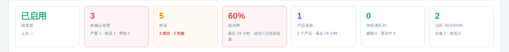

# 绿盟升级监控平台 · 用户手册（图文版）

> 版本：v1.5 · 更新：2026-11-18
>
> 本文按主导航顺序，逐页说明界面元素与操作路径，并配演示环境截图。
> 截图取自隔离演示实例（1440×900，示例数据），时间与数字仅用于说明。
> 参数默认值与接口细节见 [用户手册.md](用户手册.md)，接口定义见 [API接口文档.md](API接口文档.md)。

---

## 目录

1. [登录与界面总览](#1-登录与界面总览)
2. [仪表盘](#2-仪表盘)
3. [事件与日志](#3-事件与日志)
4. [客户](#4-客户)
5. [订阅规则](#5-订阅规则)
6. [推送历史](#6-推送历史)
7. [Session](#7-session)
8. [通知渠道](#8-通知渠道)
9. [采集数据](#9-采集数据)
10. [系统配置](#10-系统配置)
11. [典型操作流程](#11-典型操作流程)
12. [常见问题](#12-常见问题)

---

## 1. 登录与界面总览

### 1.1 登录

浏览器打开服务地址（默认 `http://<服务器IP>:9999`），进入登录页：


| 元素 | 说明 |
|------|------|
| 用户名 | 管理员账号 |
| 密码 | 登录密码 |
| 登录 | 校验通过后写入 HttpOnly 会话 Cookie；关闭浏览器前保持登录 |

> 密码错误、账号锁定等提示直接显示在表单下方。会话 Cookie 不可被前端脚本读取，CSRF 令牌单独放在可读 Cookie 中，由页面自动携带。

### 1.2 顶部导航

登录后进入主界面，左上角为品牌与主导航，右上角为用户与版本信息：

| 导航 | 用途 |
|------|------|
| 仪表盘 | 运行指标、调度任务、站点可用性、推送与采集健康 |
| Session | 绿盟站点登录态管理 |
| 通知渠道 | 邮件 / 企微 / 钉钉 / 飞书渠道配置 |
| 订阅规则 | 谁、订阅什么、通过哪些渠道、何时推送 |
| 客户 | 客户档案、持有产品与月度服务报告 |
| 采集数据 | 已采集的升级包快照与手动推送 |
| 推送历史 | 逐条投递记录、失败重推 |
| 系统配置 | 采集、存储、静默、限流、外部观测接入 |
| 产品管理 | 产品目录与自动发现结果确认（有未确认结果时带「待确认」角标） |
| 事件与日志 | 告警事件与系统日志，两种视图分段切换 |
| 🛠️ 其他工具 | CLI、备份、诊断等辅助入口 |

---

## 2. 仪表盘

仪表盘把 `/api/metrics` 的指标直接画在页面上，默认统计**最近 24 小时**，右上角可切换 **6 小时 / 7 天 / 30 天**，每 30 秒自动刷新；切到其他页面或退出登录后停止刷新。


### 2.1 顶部 KPI



| 卡片 | 看什么 | 异常表现 |
|------|--------|----------|
| 调度器 | 已启用 / 已停止，以及上次运行时间 | 停止时整卡转红并在页面顶部告警 |
| 未确认告警 | 严重 / 错误 / 警告 的未确认条数 | 数字标红，点击进入事件弹窗 |
| 推送 | 窗口内推送次数与成功 / 失败 | 失败数标红 |
| 成功率 | 已结束投递中成功的占比 | 低于 95% 转橙，低于 80% 转红 |
| 产品更新 | 窗口内有更新的产品数与更新包数 | — |
| 待投递队列 | 逾期数与重试中数量 | 逾期持续增长需排查 |
| 活跃 Session | 可用采集 / 可用发现数量 | 采集 Session 为 0 时无法采集 |

> 「逾期」不等于故障：静默时段、订阅时间窗、渠道临时异常都会让 `push_after` 到期后继续等待，关注的是逾期数是否持续增长。

### 2.2 调度任务


左列为全部定时任务，按「下次运行 + 倒计时」排序，状态用圆点表示：

- 绿点：运行中
- 红点：已停止（调度器关闭或任务异常）
- 灰点：未启用

| 任务 | 作用 |
|------|------|
| `nsfocus_collect` | 升级包采集（Quick 扫描） |
| `nsfocus_heartbeat` | Session 心跳保活 |
| `nsfocus_digest` | 汇总推送检查 |
| `nsfocus_delivery_queue` | 即时 / 延迟投递队列 |
| `nsfocus_db_cleanup` | 数据库清理（事件、快照、日志） |
| `nsfocus_channel_health` | 每日渠道体检（仅 SMTP 登录，不发信） |
| `nsfocus_site_check` | update.nsfocus.com 可用性探测 |
| `nsfocus_db_backup` | 数据库自动备份 |
| `nsfocus_db_health` | 数据库健康探针 |
| `nsfocus_cve_extract` | CVE 提取 |
| `nsfocus_cve_extract_full` | CVE 全量重扫 |
| `nsfocus_cve_meta` | CVE 评分同步（NVD / CNA） |
| `nsfocus_cnvd_import` | CNVD 数据导入 |

> 图中演示实例为保护数据关闭了调度器，因此所有任务显示灰点和「—」；生产环境正常运行时应为绿点并显示倒计时。

### 2.3 站点可用性

右列为 `update.nsfocus.com` 的探测结果：

- **监控地址 / HTTP 状态 / 响应耗时**：最近一次探测结果，正常时右上角显示绿点「正常」
- **上次检测 / 最近可用**：本地时间
- **连续失败**：连续 DOWN 的次数
- **延时曲线（最近 24 小时）**：带毫秒 Y 轴与起止时间；绿色实线为响应耗时，红色虚线区间为不可用时刻；图上方给出峰值、均值与探测失败次数
- **状态变化**：最近 3 段 UP / DOWN 的起止时间与持续时长，当前状态显示「至今」

站点连续不可用或恢复时，系统分别写入 `site_unavailable` / `site_recovered` 事件；恢复事件会自动解决对应的不可用事件。

### 2.4 CVE 情报与产品更新

- **CVE 情报**：窗口内按升级包发布日期统计严重 / 高危 / 中危 / 未评分数量，并显示评分覆盖率；点「查看全部」打开聚合弹窗。窗口内无数据时显示空态。
- **产品更新**：窗口内按产品大类聚合的更新包数与最近更新时间，跟随右上角时间筛选。

### 2.5 Session 状态与采集健康

| 卡片 | 字段 |
|------|------|
| Session 状态 | 可用采集 / 可用发现 / 采集污染 / 心跳异常但仍标记活跃 / 过期 |
| 采集健康 | 调度器、维护模式、当前状态、服务已运行时间、进程启动、上次 / 下次采集、上次耗时、近 20 轮均值、数据源超过 24h 未更新数量、订阅规则启用数与汇总模式 |

「采集健康」右上角有「立即采集」按钮，可在页面上直接触发一轮采集。

### 2.6 投递成功率与客户推送


- **投递成功率**：按渠道统计总数 / 成功 / 失败 / 待定，失败数标红；成功率低于 95% 进度条转橙、低于 80% 转红。
- **订阅规则执行 · 客户推送**：按客户统计窗口内推送次数与成功率，点击客户行下钻到该客户的推送历史（自动带上 `cust` 参数与当前天数）。

### 2.7 队列积压与数据库写


- **队列积压**：即时队列的待处理 / 已逾期 / 重试中 / 最久等待；汇总队列按规则列出待发数与最久等待时间。右上角显示本轮预算耗时与超时率。
- **数据库写**：窗口内写操作数、失败数、队列超时、SQLite 超时，以及写入耗时 P50 / P95 / P99（Python 队列、SQL 执行、合计）。分位数只覆盖最近样本。

### 2.8 事件与告警

按严重级别列出窗口内事件数与未确认数，点击数字打开与「事件与日志」页同一套逻辑的弹窗。未确认 = 未读且未解决，统计不跟随窗口。完整列表见 [3. 事件与日志](#3-事件与日志)。

### 2.9 存储与数据量

显示数据库文件大小、快照数（活跃 / 总数）、投递日志行数、汇总队列行数、系统事件行数。

---

## 3. 事件与日志

主导航「事件与日志」用一个页面承载两种视图，标题右侧的分段开关直接切换，不再有两个并列大页签。

### 3.1 事件与告警

筛选条支持：

| 筛选 | 取值 |
|------|------|
| 严重度 | 严重 / 错误 / 警告 / 信息 |
| 时间范围 | 6 小时 / 24 小时 / 7 天 / 30 天 / 全部时间 |
| 状态 | 未读 / 已读未解决 / 已解决 |

单条操作：

- **已读**：只标记为已读，不代表问题已解决
- **解决**：写入 `resolved_at`，表示处理完毕
- **展开行**：查看详情；失败投递可直接「重新入队」

批量操作严格按当前筛选范围生效：

- **批量确认**：只标记范围内**未读**的事件
- **批量解决**：只标记范围内**未解决**的事件

站点恢复、数据库锁恢复会自动解决对应事件，无需人工处理。

### 3.2 系统日志

分段开关切到「📋 系统日志」后：

| 控件 | 说明 |
|------|------|
| 日志文件 | app.log / access.log 等 |
| 级别 | INFO / WARNING / ERROR 等 |
| 行数 | 最近 N 行 |
| 自动刷新 | 定时拉取最新内容，排查时开启 |
| DEBUG | 临时开启 DEBUG 级别，用完关闭 |

### 3.3 保留期

- 已解决事件保留 **180 天**
- 未解决告警保留 **365 天**
- 由每日 **03:00** 的数据库清理任务处理

---

## 4. 客户

「客户」页维护客户档案与资产台账，是订阅规则和推送的收件人来源。

### 4.1 列表字段

| 列 | 说明 |
|----|------|
| ID / 名称 / 公司 / 邮箱 | 客户基本信息，邮箱作为推送默认收件人 |
| 产品 / 版本 | 持有产品与当前版本，如 `WEB应用防护系统(WAF)@V6.0.9` |
| 推送 / 成功率（近30天） | 近 30 天推送次数与成功率；有失败时标橙 / 红，无推送显示「近30天无推送」 |
| 附件 | 单封邮件附件上限，空表示使用全局设置 |
| 操作 | 报告 / 编辑 / 删除 |

点击「推送 / 成功率」的数值会跳转到该客户近 30 天的推送历史。

### 4.2 添加 / 编辑客户

点右上角「+ 添加客户」或行内「编辑」，弹窗字段如下：

| 字段 | 必填 | 说明 |
|------|------|------|
| 名称 | ✅ | 客户简称 |
| 公司 | ✅ | 公司全称 |
| 邮箱 | ✅ | 默认收件人，格式校验 |
| 电话 | | 联系号码 |
| 附件大小限制（MB） | | 0 = 使用全局设置，最大 50 |
| 持有产品 / 当前版本 | | 点「+ 添加产品」在路径树中一次多选；选中节点即确定产品与版本 |

资产台账规则：

- 同一产品可登记多个版本，按 `产品@版本` 去重
- 「升级包」「列表」等容器节点只用于继续展开，不会作为版本
- 已选条目以标签展示，点 × 移除
- 新建订阅规则时默认沿用这里登记的产品与版本

### 4.3 月度服务报告

点客户行的「报告」打开月度服务报告：

- 可切换上月 / 下月
- 展示当月推送明细：时间 / 产品 / 版本 / 类型 / 状态
- 汇总当月推送成功率
- 月份按北京时间划分

---

## 5. 订阅规则

订阅规则决定**什么产品的新包**通过**哪些渠道**通知**哪个客户**。

### 5.1 规则列表

| 列 | 说明 |
|----|------|
| 📢 | 回退（包撤回）通知开关 |
| 名称 | 规则名称 |
| 客户 / 收件人 | 关联客户与覆盖后的收件人 |
| 通知对象 | 机器人显示「名称(类型)」，邮箱显示收件人 |
| 订阅条件 | 产品 / 版本 / 类型路径；全部产品显示「📡 全部产品」 |
| 命中 / 最近（近30天） | 去重包数与最近命中时间；「未命中」标黄 |
| 推送 | 即时 / 每日 / 每周 / 每月 / 每季 |
| 通知模板 | 精简 / 完整等 |
| 有效期 | 失效日期，空表示长期 |
| 状态 | 启用 / 停用，点击切换 |
| 操作 | 编辑 / 删除 / 测试 |

点击「命中 / 最近」可进入该规则近 30 天的推送历史。

### 5.2 创建 / 编辑向导

顶部步骤条可点击回退，四步：

1. **基本信息**：规则名称、关联客户（选择后自动带出客户邮箱与附件上限）、有效期、启停
2. **订阅条件**：默认跟随客户档案的持有产品与版本；可手动增删路径，或勾选「📡 订阅全部产品与类型，不设筛选条件」
3. **推送策略**：延迟天数、即时 / 每日 / 每周 / 每月 / 每季汇总、推送时间窗口、包回退通知
4. **通知对象**：机器人渠道用 `+` 逐个添加；邮箱用 `+`（或 Enter）添加收件人，再添加发件渠道并按顺序主备

点「下一步」会校验当前步骤；最后一步显示客户、订阅条件、通知对象与推送模式的摘要，确认后保存。

> 重要：关联客户有邮箱 ≠ 自动发邮件。只有规则中显式添加了邮件渠道，才会发送邮件。

### 5.3 删除保护

- 删除客户前检查是否被规则引用，有引用则拒绝并提示规则名
- 删除渠道前同样检查引用关系
- 需先在规则中取消关联，再删除客户或渠道

---

## 6. 推送历史

### 6.1 筛选与下钻

顶部三个下拉 + 刷新 + 清空：

| 控件 | 说明 |
|------|------|
| 订阅规则 | 全部订阅规则 / 指定规则 |
| 客户 | 全部客户 / 指定客户 |
| 时间范围 | 近 1 天 / 3 天 / 7 天 / 30 天 / 90 天 / 1 年 / 全部 |
| 🗑 清空 | 二次确认后删除所选天数**之前**的记录，不可撤销 |

三个筛选项都写入地址栏 hash，可直接分享或从仪表盘客户卡片带参下钻。

### 6.2 列表

每个投递结果一行：

| 列 | 说明 |
|----|------|
| 时间 | 发送时间（本地时区） |
| 客户 | 收件客户 |
| 产品 / 类型 / 文件名 | 对应的升级包 |
| 紧急度 | normal / high / critical |
| 渠道 | 机器人显示类型 + 名称；邮件显示渠道名 + 发件邮箱 |
| 收件人 | 邮件为收件地址；机器人显示机器人名 |
| 状态 | ✅ 成功 / ❌ 失败 |
| 操作 | 📤 重推（携带原渠道与客户） |

分页固定**每页 200 个包**，底部显示「共 N 个包 · 第 x/y 页」，可上一页 / 下一页。没有投递记录的快照行以灰底显示，渠道、收件人、状态为「—」。

---

## 7. Session

绿盟站点需要登录才能访问升级包详情，Session 就是采集用的登录态。

### 7.1 列表与状态

页面标题显示「活跃 X/Y」，Y 为 Session 总数。表格列：

| 列 | 说明 |
|----|------|
| ID | Session 编号 |
| 类型 | 采集 / 发现；点击可修改 |
| 状态 | 活跃 / 失效 / 未知，可排序 |
| 心跳 | 正常 / 过期 / 污染 / 错误 |
| 最近心跳 / 次数 / 最后有效 / 过期 | 时间与统计 |
| 操作 | 验证 / 删除 |

心跳状态含义：

- **正常**：心跳请求返回预期页面
- **过期**：被重定向到登录 / license 页
- **污染**：访问过虚拟化上传页面，上下文被 Vm 格式干扰
- **错误**：网络或临时异常

### 7.2 添加与验证

点「+ 添加 Session」：

1. 从浏览器登录 update.nsfocus.com
2. F12 → Application → Cookies → 复制 `PHPSESSID`
3. 粘贴到弹窗，选择类型，点「验证并添加」

系统会先验证再入库；验证失败不会保存。列表中的「验证」按钮可随时复验。

### 7.3 类型修改与删除护栏

- 把**最后一个采集 Session** 改为「发现」时弹窗警告：修改后将没有可用于采集的 Session，需再次确认
- 删除**最后一个可用采集 Session** 时同样二次确认
- 点心跳徽标可查看该 Session 的心跳历史（成功 / 失败 / 延迟）

---

## 8. 通知渠道

### 8.1 列表与测试

表格显示 ID / 名称 / 类型 / 状态 / 操作。邮件渠道在名称下方附带 SMTP 主机、端口与发件人。每个渠道都有「测试」按钮：

- 机器人渠道发送一条测试消息
- 邮件渠道发送测试邮件；失败时自动打开测试日志，便于查看 SMTP 返回码

### 8.2 添加渠道

| 类型 | 必填项 |
|------|--------|
| 企业微信 | Webhook URL（可选 Secret 签名） |
| 钉钉 | Webhook URL（可选加签密钥） |
| 飞书 | Webhook URL |
| 邮件 | SMTP 服务器、端口、用户名（完整邮箱）、密码 / 授权码、发件人、SSL 选项、每小时 / 每天上限 |

安全说明：

- 编辑已有渠道时，Webhook 中的 `key` 显示为 `********`
- SMTP 密码与 Secret 不回显
- 留空表示不修改原值

### 8.3 邮件限流

三层限流，优先级：渠道 > 客户 > 全局。

| 层级 | 配置位置 | 默认 |
|------|----------|------|
| 渠道级 | 渠道编辑页 | 0 = 不限制 |
| 客户级 | 系统配置 → 邮件频率限制 | 10 封/时，50 封/天 |
| 全局级 | 系统配置 → 邮件频率限制 | 100 封/时，500 封/天 |

超限时写 WARNING 日志，投递结果标记失败并记录原因；计数器持久化，重启不丢。

---

## 9. 采集数据

按产品与版本分组展示已采集的升级包快照。

| 功能 | 说明 |
|------|------|
| 分组 | 按产品大类 → 版本分支折叠 / 展开 |
| 包详情 | 点击行展开完整信息，含页面 HASH（旧 → 新）与采集时间 |
| 推送 | 手动推送当前包，三种模式：按客户 / 按渠道 / 手动邮箱 |
| 频率限制 | 同一邮箱或渠道 1 分钟最多 5 次，超限禁用 10 分钟，按钮显示倒计时 |

手动推送忽略客户订阅的产品 / 版本条件，直接发送当前快照内容。详细字段见 [用户手册.md](用户手册.md#8-数据采集)。

---

## 10. 系统配置

页面按分区卡片双列排布（窄屏自动单列），每个分区标题右侧标注生效时机。修改后点右上角「保存配置」；采集进行中时按钮变为「强制停止并保存」。

### 10.1 分区与参数

| 分区 | 生效 | 关键项 |
|------|------|--------|
| 🔶 开关选项 | 即时 | 维护模式、API 仅限本机 |
| 📡 采集设置 | 下一轮采集 | 启用调度器、采集间隔、速率上下限、升级包跟踪数量 |
| 💾 存储与保留 | 保存后 | 附件上限、历史保留条数、自动备份间隔与保留份数 |
| 🔇 静默时段 | 保存后 | 启用、开始 / 结束时间 |
| ⏰ 高级选项 | 保存后 | 主动心跳与间隔、预检 URL、每日渠道体检 |
| 📧 邮件频率限制 | 保存后 | 全局 / 客户 × 每小时 / 每天 |
| 📤 通知联系信息 | 保存后 | 工程师姓名、邮箱、电话（三项全填才展示） |
| 🔔 系统事件通知 | 保存后 | 通知渠道、事件类型 |
| 🔌 外部观测接入 | — | Prometheus 抓取地址 |

常用项说明：

- **维护模式**：采集照常，所有推送静默（即时 / 延迟 / 手动 / 摘要），适合调试
- **API 仅限本机**：`/api/*` 仅接受 127.0.0.1，TCP 层校验不可伪造
- **速率上下限**：每次 HTTP 请求的随机间隔范围，过短易被封 IP
- **升级包跟踪数量**：每轮只入库 / 推送最新 N 个包（默认 5）
- **历史保留条数**：每个「版本 + 包类型」组合保留的快照数，超出自动删旧
- **备份**：每天 03:30 检查，距上次备份超过 N 天才生成；调小保留份数会立即清理多余备份
- **静默时段**：此时段内不发送任何通知，采集正常
- **预检 URL**：采集前 / 心跳时用于判定 Session 正常、过期或污染，修改需二次确认
- **渠道体检**：每天 04:00 只做 SMTP 连接 + 登录（不发信），失败写入「渠道体检失败」事件

### 10.2 外部观测接入

分区「🔌 外部观测接入」显示：

```
http(s)://<你的访问地址>/api/metrics?format=prometheus&hours=24
```

点「复制地址」即可粘贴到 Prometheus 的 `scrape_configs`。页面不读取、不保存、不展示抓取令牌。

服务端设置 `MONITOR_METRICS_TOKEN` 后，Prometheus 使用以下任一方式认证：

```yaml
scrape_configs:
  - job_name: nsfocus-monitor
    metrics_path: /api/metrics
    params:
      format: [prometheus]
      hours: ["24"]
    authorization:
      credentials: <MONITOR_METRICS_TOKEN>
```

或使用 `X-Metrics-Token: <token>` 请求头。未设置该环境变量时，指标接口只接受登录 JWT，Prometheus 无法直接抓取。

> 令牌只存在于服务端环境变量中，不要写入仓库、截图或工单。

---

## 11. 典型操作流程

### 11.1 新客户接入

1. **通知渠道**：确认邮件 / 机器人渠道可用，点「测试」
2. **客户**：添加客户，填名称、公司、邮箱，点「+ 添加产品」登记持有产品与当前版本
3. **订阅规则**：创建规则 → 选择客户（条件自动带出）→ 确认或调整订阅路径 → 选推送策略 → 添加机器人渠道和 / 或邮箱 → 保存
4. **验证**：在「采集数据」里选一个包，用「按客户」手动推送一次，确认能收到
5. **观察**：仪表盘「订阅规则执行 · 客户推送」和「推送历史」确认成功率

### 11.2 紧急包即时推送

1. 仪表盘「产品更新」或「采集数据」找到目标包
2. 点该包的「推送」→「按客户」选择客户，或「按通知渠道」直接发群
3. 在「推送历史」按客户筛选，确认状态为 ✅
4. 失败时点「📤 重推」，仍失败则点渠道「测试」查看 SMTP 日志

### 11.3 排障：推送失败

| 现象 | 检查 |
|------|------|
| 状态 ❌，错误含 SMTP 5xx | 渠道测试 → 测试日志；确认授权码、发件人、端口与 SSL |
| 错误含频率限制 | 系统配置 → 邮件频率限制；等待或调整上限 |
| 规则「未命中」 | 检查订阅条件、客户持有产品、规则有效期 |
| 队列逾期持续增长 | 看静默时段、推送时间窗、渠道是否可用 |
| 机器人群无消息 | Webhook 是否过期；测试发送是否成功 |

### 11.4 排障：站点不可用 / 采集异常

1. 仪表盘「站点可用性」看 HTTP 状态与连续失败；红色区间对应不可用时段
2. 「事件与日志」筛选 `site_unavailable` 与 `log_error`
3. 站点恢复后确认 `site_recovered` 事件已自动解决
4. 若仅采集失败而站点正常：检查 Session 状态（过期 / 污染）、预检 URL、日志中的解析错误

---

## 12. 常见问题

**Q：仪表盘时间比实际少 8 小时？**
A：已修复。数据库统一存 UTC，页面与业务边界（静默期、推送窗口、汇总周期、月度报告）统一按 UTC+8 计算与展示，不依赖服务器或浏览器时区。

**Q：为什么所有任务倒计时都是「—」？**
A：调度器被关闭（系统配置 → 启用调度器，或服务端未启动调度器）。开启后任务显示绿点与倒计时。

**Q：如何临时关闭所有推送？**
A：系统配置 → 开启「🔧 维护模式」。采集照常，恢复后不会补发维护期间的即时消息。

**Q：为什么客户有邮箱却收不到邮件？**
A：订阅规则里必须显式添加邮件渠道；客户邮箱只是默认收件人，不会自动触发发送。

**Q：手动推送被限制了怎么办？**
A：等待 10 分钟自动恢复，或管理员调用 `POST /api/system/rate-limits/reset` 重置（详见 [用户手册.md](用户手册.md#12-cli-管理工具)）。

**Q：清空推送历史会删掉什么？**
A：删除所选天数之前的投递记录，当前窗口内的记录保留；操作不可撤销。

**Q：升级包太多，采集变慢？**
A：系统配置 → 升级包跟踪数量，默认只处理最新 5 个；历史保留条数控制每组合保留的快照数。

---

## 附录：截图清单

| 图 | 文件 | 说明 |
|----|------|------|
| 1-1 | `images/user-manual/01-login.png` | 登录页 |
| 2-1 | `images/user-manual/02-dashboard-overview.png` | 仪表盘全貌 |
| 2-2 | `images/user-manual/02a-kpi-row.png` | 顶部 KPI |
| 2-3 | `images/user-manual/03-scheduler-site-row.png` | 调度任务与站点可用性 |
| 2-4 | `images/user-manual/02b-delivery-customer.png` | 投递成功率与客户推送 |
| 2-5 | `images/user-manual/02c-queue-dbwrite.png` | 队列积压与数据库写 |
